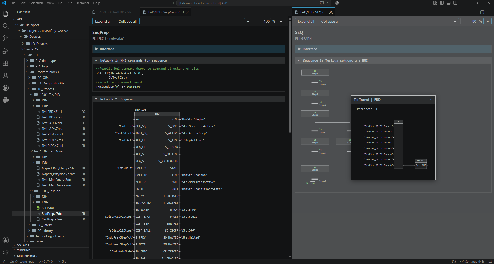
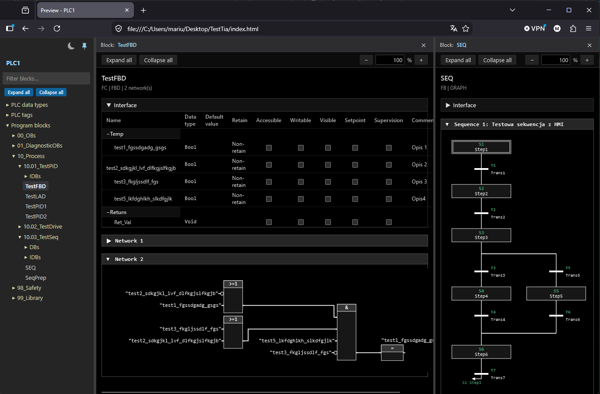
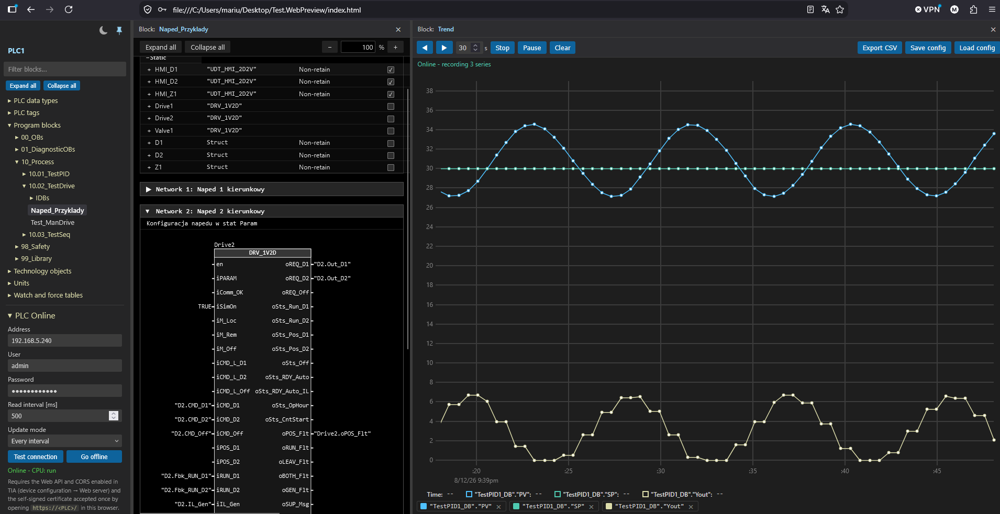

# CMsoft Viewer for TiaPortal — Viewer and Web Generator

🌐 **[www.cmsoft.com.pl](https://www.cmsoft.com.pl)** — all CMsoft extensions, the shop and contact

<!-- VERSION-BADGE -->
[](CHANGELOG.md)
<!-- /VERSION-BADGE -->

[](https://code.visualstudio.com/)
[](LICENSE.md)
[](https://www.microsoft.com/windows)
[](https://www.linkedin.com/in/mariusz-czyrnek-a33b87a6)

**Graphical viewer for Siemens TIA Portal PLC exports** — renders LAD/FBD networks, SCL/STL sources, GRAPH sequential function charts, data blocks, PLC data types, tag tables and watch tables as readable HTML directly inside VS Code or as standalone HTML files. It also generates a web preview of a whole PLC program for reviewing the software in a web browser and analysing online data.

Designed to cooperate with the [CMsoft Import for TiaPortal](https://github.com/cmariusz/TiaImportExport.VSExt) extension, which produces the export folder structure this viewer understands (`Program blocks`, `PLC data types`, `PLC tags`, `Watch and force tables`, `Technology objects`, `Units`) — but any TIA Portal XML/SD export dropped into your workspace works.

> 💡 **Tip:** Install the companion **[CMsoft Import for TiaPortal](https://marketplace.visualstudio.com/items?itemName=MariuszCzyrnek.tia-import)** extension to connect VS Code directly to TIA Portal: export blocks, tag tables and UDTs straight into your workspace (`TiaExport/...`), then view them here with one right-click — no manual exporting, no intermediate tools. The two extensions are built to work together.



---

## Key Features

### Built-in LAD / FBD / SCL / GRAPH viewer

| Capability                          | Description                                                                                                                                                                                                                                                                                                                                                                                                                                                                                                                                                                                                                                                                                                                |
| ----------------------------------- | -------------------------------------------------------------------------------------------------------------------------------------------------------------------------------------------------------------------------------------------------------------------------------------------------------------------------------------------------------------------------------------------------------------------------------------------------------------------------------------------------------------------------------------------------------------------------------------------------------------------------------------------------------------------------------------------------------------------------- |
| **Graphical preview LAD/FBD** | Render local program blocks as **interactive network diagrams** directly in a VS Code panel — no TIA Portal connection and **no external tools required**. Reads SimaticML **XML**, **`.s7dcl` + `.s7res`** source documents, **`.scl`** / **`.db`** / **`.udt`** sources and renders LAD rungs with power rail / contacts / coils / parallel branches, FBD boxes and call instances with named pins, syntax-highlighted SCL and STL (including ST inserts mixed into LAD/FBD blocks), and **GRAPH** sequential function charts as TIA-like flowcharts (steps, transitions, alternative/simultaneous branches, jumps, sequence end elements) — all following the active VS Code theme. |
| **Interface table**           | TIA-style block interface (Input / Output / InOut / Static / Temp / Constant with retain, HMI flags and comments), collapsible, with **resizable columns**; instance DB pages show the same FB-style section rows. UDT-typed members are expanded from sibling exports under `PLC data types`.                                                                                                                                                                                                                                                                                                                                                                                                                                                                             |
| **Operand & pin tooltips**    | Global operands show their PLC tag comment on hover (from `PLC tags` tables), call-box pins show the called block's pin comment, interface operands show the interface comment.                                                                                                                                                                                                                                                                                                                                                                                                                                                                                                                                           |
| **GRAPH popups**              | Clicking a transition opens its LAD/FBD logic network; clicking a step opens its action table (Interlock / Event / Qualifier / Action); hovering shows step/transition comments. While online, every active step is highlighted green — also several at once in simultaneous branches — and the transition popup shows live criteria bits (CRIT) with per-operand TRUE/FALSE states.                                                                                                                                                                                                                                                                           |
| **Failsafe styling**          | F-FBD / F-LAD blocks render with yellow wires and part outlines, like the TIA safety editor.                                                                                                                                                                                                                                                                                                                                                                                                                                                                                                                                                                                                                               |
| **Navigation**                | Right-click a call box → **Open block** opens the called FB/FC in the viewer; **Go to Source Line** jumps to the exact source line of a network, part, GRAPH step/transition or interface variable (also on DB/IDB pages). Zoom with − / % / + in the toolbar (25–400 %).                                                                                                                                                                                                                                                                                                                                                                                                                                                                                                     |
| **Classic DB sources**        | Classic non-optimized `.db` sources (`DATA_BLOCK "..."`, including a whole-body anonymous `STRUCT`) render as a flat, expanded interface table.                                                                                                                                                                                                                                                                                                                                                                                                                                                                                                                                                                       |

### Syntax highlighting in the text editor

The extension ships TextMate grammars (the same mechanism the C/C++ and C# extensions use), so opening a TIA Portal export as text — right-click → **Open source file**, or **Open With...** → **Text Editor** — gives you full syntax highlighting:

| Language id  | File type | Highlights                                                                                                                                   |
| ------------ | --------- | -------------------------------------------------------------------------------------------------------------------------------------------- |
| `tia-scl`    | `.scl`    | SCL keywords (`IF/FOR/WHILE/CASE/…`), block & VAR-section declarations, data types, `S7_*`/HMI attribute blocks, numbers (`16#…`, `T#…`), strings, comments, `#local` variables |
| `tia-s7dcl`  | `.s7dcl`  | Header attribute blocks, `FUNCTION`/`VAR_*` sections, `NETWORK`/`RUNG` structure, `wire#…` identifiers, types, strings, comments               |
| `tia-s7db`   | `.db`     | `DATA_BLOCK` declaration, `VAR`/`STRUCT` sections, `S7_*`/HMI attribute blocks, types, numbers, strings, comments                              |
| `tia-s7res`  | `.s7res`  | Multilingual resource entries: `- id:` keys, culture codes (`en-US:`) and text values                                                          |

**Code folding** — SCL and s7dcl sources get gutter fold markers (+/…) for whole blocks: `IF`/`FOR`/`WHILE`/`REPEAT`/`CASE`, `REGION` and `NETWORK`. The matcher is case-insensitive and ignores keywords inside comments and string literals.

**Choosing which files are highlighted** — the associations above are defaults; override them with the standard VS Code `files.associations` setting, e.g.:

```json
"files.associations": {
    "*.db": "plain text",   // disable highlighting for .db
    "*.udt": "tia-s7db",    // highlight UDT sources like data blocks
    "*.awlsrc": "tia-scl"   // map your own extension to the SCL grammar
}
```

**Customizing the colors** — every token carries a documented TextMate scope (`keyword.control.tia.scl`, `storage.type.tia.scl`, `comment.line.double-slash.tia.scl`, `support.constant.attribute.tia.scl`, …); restyle any of them via `editor.tokenColorCustomizations`:

```json
"editor.tokenColorCustomizations": {
    "textMateRules": [
        { "scope": "keyword.control.tia.scl", "settings": { "foreground": "#569CD6", "fontStyle": "bold" } },
        { "scope": "storage.type.tia.scl", "settings": { "foreground": "#4EC9B0" } }
    ]
}
```

### HTML Previews (standalone files)

| Capability                           | Description                                                                                                                                                                                                                                                                                                                                                                                                                                                                                                                                                                                                                                  |
| ------------------------------------ | -------------------------------------------------------------------------------------------------------------------------------------------------------------------------------------------------------------------------------------------------------------------------------------------------------------------------------------------------------------------------------------------------------------------------------------------------------------------------------------------------------------------------------------------------------------------------------------------------------------------------------------------- |
| **Generate HTML preview file** | Right-click a block source (`.xml` / `.s7dcl` / `.db` / `.scl` / `.udt`) → writes `<file>.preview.html` next to the source. Fully self-contained (styles + scripts embedded), opens in any browser. Call boxes become links to the previews of called blocks when they sit next to the source.                                                                                                                                                                                                                                                                                                                                  |
| **Whole-PLC Web Preview**      | Right-click a PLC folder → **Generate Web Preview** → pick the output folder. Every block under `Program blocks` / `PLC data types` / `Technology objects` (also inside every `Units/<unit>` folder), every tag table under `PLC tags` (`.xlsx` / `.xml`, sorted by PLC address) and every watch table under `Watch and force tables` becomes a standalone HTML page in a mirror folder tree, tied together by a self-contained `index.html` navigator: collapsible sidebar tree mirroring the TIA folder structure, block filter, split view for comparing two blocks, dark/light theme, cross-block navigation links and a **PLC Online** panel with live values, writes and a trend chart. The viewer CSS/JS is shared from a single `_assets/` copy, so even ~1200-block PLCs stay compact and open fast. |

### WinCC dynamic widgets from S7-GRAPH (SVGHMI) — experimental

> **Experimental.** The SVGHMI export is an experimental feature and does not have its full functionality yet — what it does and does not do is described under *Generating WinCC SVGHMI widgets from GRAPH sequences* below.

| Capability                              | Description |
| --------------------------------------- | ----------- |
| **Generate WinCC SVGHMI (GRAPH)** | Right-click an S7-GRAPH block export (`.xml`) or a whole folder → every GRAPH sequence becomes a **dynamic SVG widget (`.svghmi`) for WinCC Unified and WinCC V8**: the TIA-like sequence chart of the viewer whose step and transition states are widget parameters. Bound to the instance DB of the GRAPH FB, active steps turn green, steps with an interlock warning yellow, steps with a supervision fault red, fulfilled transitions green — all colors are widget parameters too. Like in the web preview, a **tap on a step or transition opens its view** (interlock / supervision / condition networks with the live TRUE/FALSE criteria, action table, manual Enable/Disable) and the **Sequence control** station switches modes, initializes, acknowledges and steps the sequence. A `<widget>.bindings.json` lists the tag of every parameter for each instance of the FB. |
| **SVGHMI preview** | Opening any `.svghmi` file — generated here or from a widget library — shows the widget the way the WinCC runtime draws it: every `hmi-bind` expression is evaluated with the parameter values of a side panel (checkboxes, numbers, color pickers), so states can be tried before importing the widget. Edits of the XML re-render live, and a findings list checks the file against the Siemens SVGHMI rules (DOCTYPE, `hmi:self`, CSS/scripts, undeclared parameters, invalid expressions). |

---

## FREE and PRO

CMsoft Viewer for TiaPortal is free to use; a **CMsoft Viewer for TiaPortal PRO** license unlocks the generated previews, unlimited online monitoring and the AI tools:

| Feature                                                                                   | FREE                   | PRO                |
| ----------------------------------------------------------------------------------------- | ---------------------- | ------------------ |
| Graphical LAD/FBD/SCL/GRAPH preview in VS Code, SVGHMI widget preview, syntax highlighting, Review last changes | ✅                     | ✅                 |
| PLC Online in the VS Code preview (live values, write to PLC)                             | 1 minute per connection | ✅ unlimited      |
| Online trend chart in VS Code                                                             | 1 variable             | ✅ up to 10        |
| Generate HTML preview file                                                                | ⛔                     | ✅                 |
| Generate Web Preview (whole PLC in the browser, PLC Online, trends)                       | ⛔                     | ✅                 |
| Generate WinCC SVGHMI widgets from S7-GRAPH sequences (WinCC Unified, WinCC V8) — experimental | ⛔                     | ✅                 |
| Copilot language model tools, MCP server                                                  | ⛔                     | ✅                 |

When the FREE minute of a PLC connection is used up, the preview goes offline — press **Go online** again to continue.

**Activating PRO:** run **CMsoft Viewer for TiaPortal: Manage License / Subscription** (or click **CMsoft** in the status bar — one item lists the licenses and the manuals of all installed CMsoft extensions). The license panel offers a **free 14-day trial**, **Buy online** (one month or one year per license - a license covers one computer - as a subscription that renews automatically or as a one-time payment without renewal — current prices on the [purchase page](https://extensions.cmsoft.com.pl/pricing?product=tia-viewer)), ordering by e-mail, or activating a license key you already have. An order names the buyer's company and country. **Refresh license status** fetches this computer's license from the license server — e.g. after a purchase whose panel was closed before the payment was confirmed. With an active license the panel shows **Your license**, with **Extend license** for a license that does not renew on its own and **Cancel subscription** for a renewing subscription (it ends with the paid period). The license is bound to the computer (a hashed hardware ID); deactivating it only removes it from this computer - to move it to another computer, contact the vendor. See [TERMS.md](TERMS.md) and [PRIVACY.md](PRIVACY.md).

---

## Requirements

| Requirement       | Version                                            |
| ----------------- | -------------------------------------------------- |
| **OS**      | Windows 10 / 11                                    |
| **.NET**    | .NET Framework 4.8 (preinstalled on Windows 10/11) |
| **VS Code** | ≥ 1.95.0                                          |

Nothing else needs to be installed — no Node.js, npm or build tools: the extension comes ready to run, and VS Code provides its runtime.

> **No TIA Portal required.** The viewer reads export files from disk only. Use the [CMsoft Import for TiaPortal](https://github.com/cmariusz/TiaImportExport.VSExt) extension (or TIA Portal's built-in export) to produce the files.

---

## Installation

1. Install the extension from VS Code Marketplace (or `code --install-extension MariuszCzyrnek.tia-viewer`)
2. **Recommended:** install the companion **[CMsoft Import for TiaPortal](https://marketplace.visualstudio.com/items?itemName=MariuszCzyrnek.tia-import)** extension (`code --install-extension MariuszCzyrnek.tia-import`) to export PLC programs directly from TIA Portal into your workspace
3. Open a workspace containing TIA Portal exports (e.g. a `TiaExport/Projects/...` tree created by CMsoft Import for TiaPortal)
4. Double-click a block file in the Explorer — by default it opens in the text editor; set `tiaViewer.editor.openOnClick` to `preview` to open the graphical viewer on click instead (or right-click a file / a PLC folder and pick a preview command)

---

## Usage

### Previewing a block (interactive webview)

Double-click (or single-click preview) a SimaticML **XML** block, a **`.s7dcl`** source document (the matching `.s7res` is picked up automatically), or a **`.scl`** / **`.db`** / **`.udt`** source in the VS Code Explorer to open it. What a click opens is controlled by the **`tiaViewer.editor.openOnClick`** setting: `source` (the default) opens the block source in the regular text editor, `preview` opens the graphical viewer. Alternatively, right-click the file and choose **Graphical preview LAD/FBD**. XML files that are not TIA Portal exports always open in the regular text editor, and for any supported file the other option stays available via right-click → **Open source file** / **Graphical preview LAD/FBD** (or **Open With...**).

The viewer renders the block interface (resizable, collapsible columns), LAD rungs, FBD networks, syntax-highlighted SCL/STL and GRAPH sequence flowcharts — all following the active VS Code theme. Networks and the interface panel are collapsible (including Expand all / Collapse all), operand labels and call-box pins show comments as tooltips, and the toolbar zooms the page with − / % / + (25–400 %). In a GRAPH flowchart, clicking a transition opens a popup with its LAD/FBD logic network, clicking a step opens its action table, and hovering a step or a transition shows its comment.

Right-click inside the preview for **Open block** (on a call box) and **Go to Source Line** (on networks and parts, GRAPH steps/transitions and interface variables).

### Generating a standalone HTML preview file (PRO)

1. Right-click one or more block sources (`.xml` / `.s7dcl` / `.db` / `.scl` / `.udt`).
2. Choose **Generate HTML preview file**.
3. The preview is written as `<source-file>.preview.html` next to the source; the notification offers an **Open File** button.

### Generating a whole-PLC web preview (PRO)

1. In VS Code Explorer, right-click the **PLC folder** (the one containing `Program blocks` / `PLC data types` / `PLC tags` / `Watch and force tables` / `Technology objects` / `Units`).
2. Choose **Generate Web Preview** and pick the output folder in the dialog. The progress notification can be cancelled — the navigator is then built from the pages generated so far.
3. Open the generated `index.html` in a browser (the notification offers an **Open Preview** button).

Every block source under `Program blocks`, `PLC data types` and `Technology objects` — at the PLC root and inside every `Units/<unit>` folder — is rendered into a mirror folder tree of standalone previews (with clickable cross-block navigation links), every tag table under `PLC tags` gets a table page sorted by PLC address, and every watch table under `Watch and force tables` a table page with a **Monitor value** column. The `index.html` navigator provides a collapsible sidebar tree mirroring the TIA folder structure, a block filter, expand/collapse all, a split view for comparing two blocks side by side and a dark/light theme toggle. A logo sits in its top-left corner, above the PLC name — the CMsoft logo, or your own PNG image set in **`tiaViewer.webPreview.logoFile`** (a missing file or one that is not a PNG is reported, and the CMsoft logo is shown instead). The viewer CSS/JS is written once to `_assets/` and shared by all pages, so the output stays compact even for large PLCs.



#### PLC Online (live values)

The navigator sidebar contains a collapsible **PLC Online** panel that connects the preview directly to a SIMATIC S7 CPU (S7-1500 / S7-1200 G2) through its built-in web server (JSON-RPC API — see `.github/SimaticWebApi.md`):

1. Expand **PLC Online**, enter the CPU **address**, a **user** and **password** (a user with read access configured in TIA User Management; the page keeps the password in memory only — the login fields are a regular form, so your browser's password manager may offer to save it).
2. Pick the **read interval** (ms) and the **update mode** — *Every interval* rewrites all values each cycle, *Only on change* updates the table only when a value actually changes.
3. Press **Test connection** to verify HTTPS reachability and the credentials without going online (the status line reports the result and the CPU operating mode, or a missing-permissions hint).
4. Press **Go online**. The status line shows the connection state and the CPU operating mode (run/stop). Press **Go offline** to disconnect and log out.

While online, opening a **watch table** from the tree shows a **Monitor value** column with live values of the watched tags, refreshed at the configured interval.

The same live monitoring works on **data block pages** (global DBs and instance DBs, including technology object instance DBs): the interface table gains a **Monitor value** column right after the variable name. Only variables with the **Accessible from HMI/OPC UA** attribute (`ExternalAccessible`) are monitored — the flag is inherited down the member tree, so expanding a struct, UDT or multi-instance FB reveals live values for its elements. Arrays of elementary types are monitored per element (`"DB"."arr"[0]`; arrays over 256 elements, arrays of Struct/UDT and whole structs cannot be read through the web API — use a watch table for those). The attribute flags shown in the expanded rows are filled in from the UDT/FB type export when the DB export omits them.

**FB pages** monitor the data of a picked instance instead: an **Instance** selector in the toolbar lists the block's instance DBs and multi-instance paths, the interface table gains the same **Monitor value** column (paths relative to the picked instance) and network operand labels get live values next to them. On **GRAPH** function blocks the flowchart itself goes online too: every active step is highlighted **green** (the step's `X` flag — in simultaneous branches several steps are active at once), and a transition popup shows the transition's criteria bits — the `CRIT` value (hex + decimal) plus a **TRUE** (green) / **FALSE** (blue) state under every condition operand, decoded from the single polled `CRIT` value (bit N = N-th condition operand; the operand variables themselves are not read). The same online view is available in the VS Code graphical preview panel (PLC Online panel on the right side of the preview — it closes automatically when you click outside it). There the connection runs through the extension over TLS 1.2 and needs no browser exception: the first connection to a CPU shows the fingerprint of its certificate and asks you to trust it (a certificate Windows trusts — e.g. one issued by the TIA Portal project CA whose root you installed — is accepted without asking), and a CPU that later presents a different certificate is refused with a warning until you trust the new one. **CMsoft Viewer for TiaPortal: Manage Trusted PLC Certificates** forgets trusted certificates. Several preview panels on the same PLC share one web API session, and the password is kept in the VS Code secret storage, separately for every PLC address and user — a remembered password is never offered to another PLC.

While online, clicking the monitor value of a variable with the **Writable from HMI/OPC UA** attribute (`ExternalWritable`) — in the interface table or next to a network operand — opens a write popup (value input, or **TOGGLE** for Bool) that writes the value through `PlcProgram.Write`. GRAPH sequencer FBs with the standard `INIT_SQ` / `OFF_SQ` / `ACK_EF` inputs additionally get a floating **Sequence control** panel (Initialize, Deactivate all, Acknowledge, mode selection, Next, manual step selection) that writes through the variables wired to the pins of the sequence call.

Prerequisites on the PLC/TIA side: the web server must be enabled on the CPU, **CORS must be allowed** in the web server settings, and — because S7 CPUs use a self-signed certificate by default — open `https://<cpu-address>/` in the browser once and accept the certificate exception before going online.

#### Online trend chart

While online, right-click any monitored variable row on a data block or FB page (or a live network operand label on an FB page) and choose **Add to chart** to open a live trend in the split view (uPlot-based, up to 10 series, BOOL charted as 0/1). The menu also lets you assign the series to an existing Y axis or create a **New Y axis** for it (up to 5 axes; extras stack on the right with their own scale, and disappear when their last series is removed). The chart records a timestamped sample on every poll and keeps a ring buffer trimmed to the **Max recording time** from the **Trend** panel in the navigator sidebar (default 10 min — retention only; the panel also has an **Open chart** button); in the VS Code preview the same setting sits under a **settings gear** on the chart toolbar and is remembered across sessions. The visible time window auto-scrolls with the live edge and is set independently on the chart toolbar (default 30 s, clamped to the retention); pan back with **◀** **▶** to freeze it (recording continues) and press **Follow** to re-attach. Drag-select a range on the chart to zoom into it (the window field shows the dragged span); double-click returns to live follow. Hover the chart for cursor values in the legend; click a legend label to hide/show a series (ctrl-click isolates it). The toolbar also offers pause (redraws only), clear, CSV export and saving/loading the chart configuration as JSON (in VS Code through its save / open dialog). Going offline stops the recording and keeps the samples — the chart shows the pause as a gap, CSV export still works, **Clear** removes them.



#### Copilot tools (PLC online, PRO)

While a preview panel is online, GitHub Copilot (agent mode / chat participants) can access the PLC through the extension's language model tools — they reuse the panel's online session and never ask for credentials:

| Tool                  | Reference       | Description                                                                                                                                      |
| --------------------- | --------------- | ------------------------------------------------------------------------------------------------------------------------------------------------ |
| PLC Online Sessions   | `#plcSessions`  | List the PLCs with an active online session (host, web API user).                                                                                |
| Read PLC Variables    | `#plcRead`      | Read online values of variables (`"DB"."Member"…` paths, PLC tags). Requires **Accessible from HMI/OPC UA** on DB members.                        |
| Write PLC Variable    | `#plcWrite`     | Write one online variable (`PlcProgram.Write`). Requires **Writable from HMI/OPC UA**; every write is confirmed by you (see the setting below).    |
| Trend Data            | `#plcTrendData` | List/read the archived trend series, and start/stop **autonomous recording** (`action: "record"`/`"clear"`) — no chart interaction needed.        |

The Accessible/Writable attributes are verified against the exported block sources in the workspace (found anywhere — `Program blocks`, `Units/<unit>`, `Technology objects` or loose PLC folders) by the same code that marks the interface table, so the tools follow exactly its inheritance rules. Whole structures and arrays are refused with a reason — read or write their members and elements one by one. This enables agentic workflows such as PID tuning: Copilot records the controller's setpoint / process value / output into the trend, reads the step response, writes adjusted parameters and repeats — you only go online once and confirm the writes. Writes are confirmed per call unless you enable `tiaViewer.lmTools.autoConfirmPlcWrites` (use only in safe setups — writing to a running PLC affects the controlled process).

#### MCP server (PLC online for external agents, PRO)

The extension also runs a localhost-only **MCP server** (Streamable HTTP, `http://127.0.0.1:<port>/mcp`) that exposes the same four `tia_viewer_*` tools to any MCP client — Claude Desktop, coding agents, your own scripts. With a PRO license it starts with the extension (disable via `tiaViewer.mcp.enabled`); clients read the connection info from the state file `.tia/mcp-viewer.json`. VS Code's own Copilot uses the language model tools above, so the server is not offered to VS Code as an MCP server (it would list every tool twice):

```json
{ "version": 1, "host": "127.0.0.1", "port": 58470, "token": "…", "endpoint": "/mcp", "transport": "streamable-http" }
```

The file is always written to the extension's global storage, and to the workspace as well once the workspace is used for TIA work (unless `tiaViewer.mcp.writeWorkspaceStateFile` is disabled); the workspace copy is listed in `.tia/.gitignore`, so the token does not end up in the project's repository. The port and the per-start Bearer `token` change on every activation, so clients must read the file each session; `GET /health` (no auth) returns the tool list. The server answers only requests addressed to the loopback interface — a `Host` or browser `Origin` naming another host is refused (DNS rebinding protection). PLC writes requested by an MCP client are confirmed by **you** with a modal VS Code dialog unless `tiaViewer.lmTools.autoConfirmPlcWrites` is enabled. Command Palette: **CMsoft Viewer for TiaPortal: Start MCP Server** re-enables the server when it was disabled.

### Generating WinCC SVGHMI widgets from GRAPH sequences (PRO, experimental)

> **Experimental — not the full functionality yet.** The export writes the sequence chart, the step and transition views and the *Sequence control* station, but:
>
> - it does not connect the widget to tags — WinCC does that when the widget is placed on a screen, and `<widget>.bindings.json` is only the checklist for it;
> - the views and the station use the event model of the WinCC Unified controls, which Siemens does not document for custom widgets: they are meant for the WinCC Unified PC Runtime; for WinCC V8 and the Unified Comfort Panels use the display-only chart;
> - the widgets were checked against the Siemens SVGHMI rules and in the SVGHMI preview of this extension, not in every WinCC runtime.
>
> Test every widget in your target runtime before you use it on a plant.

1. Right-click an S7-GRAPH block export (SimaticML `.xml`) — or a folder, which is searched recursively for GRAPH blocks — and choose **Generate WinCC SVGHMI (GRAPH)**. While the graphical preview shows a GRAPH block, the same command sits as a button in the editor title bar.
2. One widget file is written per sequence: `GRAPH_<block>.svghmi` (`GRAPH_<block>_Seq<n>.svghmi` for blocks with several sequences), next to the export — or into the folder set in **`tiaViewer.svghmi.outputFolder`**. Point that setting at the project's `UserFiles\SVGControls` folder to write the widgets straight where WinCC picks them up.
3. **WinCC Unified (TIA Portal):** copy the files into `<TIA project folder>\UserFiles\SVGControls` (create the folder if needed), open a screen and refresh the **Dynamic widgets** of the toolbox — the widget appears under its name (`GRAPH_<block>`). **WinCC V8:** copy the file into the `GraCS` folder of the project, insert it in the Graphics Designer as an SVG object and dynamize its properties in the object properties; its file name and widget name must be unique among the project's dynamic widgets.
4. Place the widget on a screen and bind its parameters to the members of the GRAPH FB's **instance DB** (unbound parameters keep their default, so binding only `_X` already shows the active steps). The export writes **`<widget>.bindings.json`** next to the GRAPH export: for every instance of the FB found among the exported blocks (instance DBs and multi-instances) the exact tag of each parameter — e.g. `Step1_X` → `"SEQ_IDB".Step1.X`, `INIT_SQ` → the variable wired to the `INIT_SQ` pin of the FB call. The **CMsoft Viewer for TiaPortal** log shows the same table.

| Parameter      | Bind to                         | Effect                                     |
| -------------- | ------------------------------- | ------------------------------------------ |
| `<step>_X`     | `"<instance DB>".<step>.X`      | step active → `ActiveColor` (green)        |
| `<step>_LA`    | `"<instance DB>".<step>.LA`     | interlock not fulfilled → `WarningColor` (yellow, while active) |
| `<step>_VA`    | `"<instance DB>".<step>.VA`     | supervision fault → `FaultColor` (red, while active) |
| `<transition>_TT` | `"<instance DB>".<transition>.TT` | transition condition fulfilled → `ActiveColor` bar |
| `<step>_CRIT_LOC` | `"<instance DB>".<step>.CRIT_LOC` | interlock criteria (DWord) → TRUE/FALSE of every interlock operand in the step view |
| `<transition>_CRIT` | `"<instance DB>".<transition>.CRIT` | transition criteria (DWord) → TRUE/FALSE of every condition operand in the transition view |
| `AUTO_ON`, `TAP_ON`, `TOP_ON`, `MAN_ON`, `ERR_FLT` | `"<instance DB>".AUTO_ON` … | active mode and the error indicator of the header strip / station |
| `INIT_SQ`, `OFF_SQ`, `ACK_EF`, `SW_AUTO`, `SW_TAP`, `SW_TOP`, `SW_MAN`, `T_PUSH`, `S_SEL`, `S_ON`, `S_OFF` | the variable wired to the pin of the FB call, else `"<instance DB>".INIT_SQ` … | **two-way** commands the station writes (true while the button is pressed; `S_SEL` = step number) |
| `BackColor`, `StepColor`, `ActiveColor`, `WarningColor`, `FaultColor`, `LineColor`, `TextColor` | — (HmiColor `0xAARRGGBB`) | colors of the chart; `BackColor` defaults to transparent |
| `DarkTheme` | — (Boolean; `true` on screens with a dark design, or a tag that switches the design) | dark theme: `StepColorDark`, `LineColorDark`, `TextColorDark` replace `StepColor`, `LineColor`, `TextColor`, and the header strip, the views and the station turn dark |
| `StepColorDark`, `LineColorDark`, `TextColorDark` | — (HmiColor `0xAARRGGBB`) | colors of the chart in the dark theme (the state colors and `BackColor` serve both themes) |

The notification after the export offers **Open Preview** — see the next section — and **Open Bindings**.

**Step and transition views, sequence control.** A tap on a step opens its view next to it — `S<n> - <name>: <action title>` with the **Interlock -(c)-** network (live TRUE/FALSE per operand from `CRIT_LOC`), the **Supervision -(v)-** network, the **action table** and, with the station, **Enable step / Disable step** (`S_SEL := n` + `S_ON`/`S_OFF`, manual mode only); a tap on a transition opens its condition network with the live `CRIT` bits. A tap on the same element or × closes the view; the open element is outlined. The **Sequence control** button of the header strip (FBs with the standard `INIT_SQ` / `OFF_SQ` / `ACK_EF` inputs) opens the station of the web preview: **Initialize**, **Deactivate all**, **Acknowledge**, the mode radios (Automatic / Semiautomatic with **Ignore transition** / Manual), **Next** (step with transition) and the manual step selection (− S<n> + or a tap on a step, **Enable** / **Disable**); the mode-bound buttons are dimmed and inactive outside their mode, like in the web preview. The header also shows the active mode and a red `ERR_FLT` badge.

The widget only shows and writes its parameters — WinCC connects them to tags when the widget is placed on a screen; a dynamic SVG cannot bind itself. Connecting them automatically would need TIA Portal Openness (creating the screen item and its tag dynamizations in the project); until then `<widget>.bindings.json` is the checklist. The views and the station use `hmi:action` / `hmi-event` with two-way parameters — the event model of the WinCC Unified controls, which Siemens does not document for custom widgets: they run in the WinCC Unified PC Runtime; for WinCC V8 or Unified Comfort Panels turn `tiaViewer.svghmi.detailViews` and `tiaViewer.svghmi.sequenceControl` off to get the display-only chart. Bind the commands to the variables wired at the FB call when there are any: the call overwrites the instance DB inputs every cycle.

GRAPH names the instance DB members after the steps and transitions, so `Step1_X` belongs to `"SEQ_IDB".Step1.X`. Names that are not plain identifiers are sanitized (`Branch A` → `Branch_A_X`); the header comment of the file and the **CMsoft Viewer for TiaPortal** log list every parameter with the member it belongs to. `tiaViewer.svghmi.stepFaultStates` / `tiaViewer.svghmi.transitionStates` drop the `_LA`/`_VA` resp. `_TT` parameters for a shorter parameter list; `_CRIT_LOC` / `_CRIT` exist only for networks with operands (S7-1500 GRAPH has no supervision criteria, so the supervision network shows no live bits). The widget scales with its size on the screen (keep the aspect ratio); very long sequences are best placed in a scrollable screen window.

### Previewing SVGHMI widgets

Double-click a `.svghmi` file in the Explorer (or right-click → **Open SVGHMI Preview**) — any dynamic SVG widget, generated by CMsoft Viewer for TiaPortal or taken from a widget library:

- The widget is drawn the way the WinCC runtime draws it: every `hmi-bind` expression (`{{Converter.RGBA(ParamProps.Color)}}`, `{{ParamProps.On ? 'inline' : 'none'}}`, `translate({{…}})`, local tags, dynamic `hmi:text`) is evaluated with the parameter values of the panel on the right — Boolean parameters as checkboxes, numbers as fields, `HmiColor` parameters as color pickers. Values differing from the default are highlighted; **Reset** restores the defaults.
- **Click a shape** to list only its parameters; **double-click** toggles its first Boolean parameter — on a generated GRAPH widget, double-clicking a step switches the step active.
- The widget's own **actions** (`hmi:action` with `hmi-event:tapped` / `down` / `up` / `mouseLeave`) run like in WinCC Unified: on a generated GRAPH widget a tap opens the step/transition views and the station buttons pulse their commands. Values the widget writes to **two-way** parameters (marked ⇄) update the panel and are listed under *Widget writes*; `enum` parameters get a drop-down.
- **Zoom** with the toolbar buttons or Ctrl+wheel, **Fit** fits the widget into the window; the background imitates a light or dark WinCC screen, a transparency grid or the editor theme. A widget with a Boolean `DarkTheme` parameter — the generated GRAPH widgets — follows the background: the dark screen (or the editor theme of a dark VS Code theme) sets it, the light screen clears it.
- **Findings** check the file against the Siemens SVGHMI rules: missing DOCTYPE or `<hmi:self>`, a name without `extended.`, `preserveAspectRatio` other than `none`, CSS styles, scripts, animations, `foreignObject`, parameters or local tags used but not declared, events pointing at missing actions, actions writing parameters that are not two-way, and every expression that fails to evaluate. What WinCC would not render (CSS, scripts, external references) is not rendered by the preview either.
- **Open source file** in the editor title shows the XML; edits re-render the preview live, keeping the parameter values.

### Supported input formats

| Format                        | Extension               | Description                                                                                                                    |
| ----------------------------- | ----------------------- | ------------------------------------------------------------------------------------------------------------------------------ |
| **SimaticML XML**       | `.xml`                | Standard TIA Portal export — blocks (OB/FB/FC/DB), UDTs, tag tables                                                           |
| **SD source documents** | `.s7dcl` + `.s7res` | SIMATIC Source Documents (TIA Portal V20+) — LAD/FBD graphical source + multilingual comments                                 |
| **SCL source**          | `.scl`                | `FUNCTION_BLOCK` / `FUNCTION` / ... external source — header + VAR sections as interface, body as highlighted source text |
| **Classic DB source**   | `.db`                 | `DATA_BLOCK "..."` source with inline attributes and trailing `//` comments                                                |
| **UDT source**          | `.udt`                | `TYPE ... END_TYPE` source                                                                                                   |
| **Tag tables**          | `.xlsx` / `.xml`    | PLC tag tables (Tags and Constants sheets) — used for whole-PLC previews and operand tooltips                                 |
| **Watch and force tables** | `.xml`             | SimaticML watch/force table exports — table preview in VS Code, live values in the whole-PLC web preview                     |
| **Dynamic SVG widgets** | `.svghmi`             | WinCC Unified / WinCC V8 dynamic widgets — interactive preview with a parameter panel                                         |

### Expected folder layout

The viewer works on any single file, but unlocks its full power (UDT expansion, tag tooltips, Open block navigation) when the exports follow the structure produced by CMsoft Import for TiaPortal:

```
<PLC folder>/
├── Program blocks/           # OB / FB / FC / DB exports
├── PLC data types/           # UDT exports
├── PLC tags/                 # tag tables (.xlsx / .xml)
├── Watch and force tables/   # watch / force tables (.xml)
├── Technology objects/       # technology object instance DBs (PID, motion, …)
└── Units/<unit>/             # software units — each with its own Program blocks / PLC data types / …
```

Sibling folders are located by walking up to 6 parent directories from the viewed file.

---

## Commands

| Command                        | Where                                                                        | Description                                     |
| ------------------------------ | ---------------------------------------------------------------------------- | ----------------------------------------------- |
| `Graphical preview LAD/FBD`  | Explorer right-click on `.xml` / `.s7dcl` / `.db` / `.scl` / `.udt`, Command Palette (the file of the active editor) | Open the block in the interactive viewer panel  |
| `Review last changes`        | Explorer right-click on a block source, Command Palette (the active file)    | Open the graphical preview with the git changes highlighted (uncommitted changes, else the last commit of the file) |
| `Open source file`           | Explorer right-click on a block source or `.svghmi` file, editor title of the SVGHMI preview, Command Palette (the source of the active preview) | Open the source in the text editor (bypasses the graphical default editor) |
| `Generate HTML preview file` | Explorer right-click on block source(s)                                      | Write `<file>.preview.html` next to the source (PRO) |
| `Generate Web Preview`       | Explorer right-click on a PLC folder, Command Palette (the PLC of the active file) | Render the whole PLC to a browsable HTML site (PRO) |
| `Generate WinCC SVGHMI (GRAPH)` | Explorer right-click on GRAPH block export(s) / a folder, editor title of a GRAPH preview | Write the GRAPH sequences as dynamic SVG widgets (`.svghmi`) for WinCC Unified / WinCC V8 (PRO, experimental) |
| `Open SVGHMI Preview`        | Explorer right-click on a `.svghmi` file, editor title of its text editor   | Open the widget preview (to the side when invoked from the text editor) |
| `Open block`                 | Preview right-click on a call box                                            | Open the called FB/FC in the viewer             |
| `Go to Source Line`          | Preview right-click on a network / part / GRAPH step or transition / interface variable | Jump to the source line in the editor           |
| `CMsoft Viewer for TiaPortal: Start MCP Server` | Command Palette                                                                      | Enable the MCP server when it was disabled      |
| `CMsoft Viewer for TiaPortal: Show Logs`      | Command Palette                                                              | Open the extension output channel               |
| `CMsoft Viewer for TiaPortal: Manage Trusted PLC Certificates` | Command Palette                                             | Forget certificates of PLCs you trusted when going online (the next connection asks again) |
| `CMsoft Viewer for TiaPortal: Forget Saved PLC Passwords` | Command Palette                                                  | Forget the PLC passwords the preview saved (per PLC address and user; the next connection asks again) |
| `CMsoft Viewer for TiaPortal: Open User Manual` | Command Palette, **CMsoft** status bar item → Manuals                         | Open the user manual (English, with screenshots) in VS Code's Markdown preview |
| `CMsoft Viewer for TiaPortal: Search User Manual` | Command Palette                                                            | Pick a chapter or section of the manual; it opens there |
| `Help: CMsoft Manuals…`      | Command Palette                                                              | The manuals of every installed CMsoft extension |
| `CMsoft Viewer for TiaPortal: Manage License / Subscription` | Command Palette, **CMsoft** status bar item                  | License panel: free trial, buy online, activate a key, hardware ID |
| `CMsoft Viewer for TiaPortal: Show Welcome & Pricing` | Command Palette                                                      | Show the FREE / PRO overview and pricing        |
| `CMsoft Viewer for TiaPortal: Buy License`    | Command Palette                                                              | Open the CMsoft Viewer for TiaPortal PRO purchase page           |
| `CMsoft Viewer for TiaPortal: Refresh License Status` | Command Palette                                                      | Fetch this computer's license from the license server (e.g. a purchase whose panel was closed) and renewed keys |
| `CMsoft Viewer for TiaPortal: Activate License Key` / `Deactivate License on this Computer` | Command Palette                     | Activate a license key you received / remove the license from this computer |
| `CMsoft Viewer for TiaPortal: Generate Activation Token` / `Copy Hardware ID` / `Save License Key to File` | Command Palette     | Offline activation by e-mail and license key backup |

## Settings

| Setting                                | Values                     | Default  | Description                                                                                                              |
| -------------------------------------- | -------------------------- | -------- | ------------------------------------------------------------------------------------------------------------------------ |
| `tiaViewer.editor.openOnClick`         | `source` / `preview`     | `source` | What clicking a block file (`.s7dcl` / `.db` / `.scl` / `.udt` / SimaticML `.xml`) in the Explorer opens — the block source in the text editor or the Graphical LAD/FBD preview. The other option stays available via right-click → **Open With...** |
| `tiaViewer.webPreview.logoFile`          | PNG file path            | (empty)  | The logo **Generate Web Preview** shows in the top-left corner of the navigator, above the PLC name and the block tree — e.g. your company logo; empty: the CMsoft logo. Relative paths and `${workspaceFolder}` resolve against the workspace folder |
| `tiaViewer.svghmi.outputFolder`          | folder path              | (empty)  | Where **Generate WinCC SVGHMI (GRAPH)** writes the `.svghmi` widgets — e.g. `<project>\UserFiles\SVGControls`; empty: next to the GRAPH export. Relative paths and `${workspaceFolder}` resolve against the workspace folder |
| `tiaViewer.svghmi.stepFaultStates`       | `true` / `false`         | `true`   | Add the `<step>_LA` / `<step>_VA` parameters (interlock warning / supervision fault coloring) to every step |
| `tiaViewer.svghmi.transitionStates`      | `true` / `false`         | `true`   | Add the `<transition>_TT` parameter (fulfilled transition coloring) to every transition |
| `tiaViewer.svghmi.detailViews`           | `true` / `false`         | `true`   | Step/transition views opened by a tap, with the `_CRIT_LOC` / `_CRIT` criteria parameters (WinCC Unified Runtime) |
| `tiaViewer.svghmi.sequenceControl`       | `true` / `false`         | `true`   | The *Sequence control* station with the mode outputs and the two-way command parameters (WinCC Unified Runtime) |
| `tiaViewer.svghmi.bindingsFile`          | `true` / `false`         | `true`   | Write `<widget>.bindings.json` (the tag of every parameter per FB instance) next to the GRAPH export |
| `tiaViewer.lmTools.autoConfirmPlcWrites` | `true` / `false`         | `false`  | Skip the confirmation dialog when a Copilot language model tool or an MCP client writes a variable to the online PLC — enable only in safe setups |
| `tiaViewer.mcp.enabled`                  | `true` / `false`         | `true`   | Run the localhost-only MCP server (Streamable HTTP, PRO) exposing the `tia_viewer_*` PLC online tools to MCP clients; the endpoint and Bearer token are written to `.tia/mcp-viewer.json` while running |
| `tiaViewer.mcp.writeWorkspaceStateFile`  | `true` / `false`         | `true`   | Also write the `.tia/mcp-viewer.json` state file into workspaces used for TIA work, so external agents can discover the endpoint and token |
| `tiaViewer.license.serverUrl`            | URL                      | `https://extensions.cmsoft.com.pl/api/v1` | License server used by the license panel (trial, buy online, subscription renewals) |
| `tiaViewer.license.purchaseUrl`          | URL                      | `https://extensions.cmsoft.com.pl/pricing` | Purchase page (`?product=tia-viewer` is appended) |
| `tiaViewer.license.contactEmail`         | e-mail                   | `subscription@cmsoft.com.pl` | Address the activation request is sent to when ordering by e-mail |

---

## How it works

The viewer reads the export files from disk and draws them with its own .NET Framework 4.8 library, which runs inside VS Code — it needs neither TIA Portal nor any other Siemens software. **PLC Online** and the online values of the web preview come from the web server of the PLC, over HTTPS (the user manual describes how to prepare the PLC).

---

## Documentation

- **User manual** — in VS Code: **CMsoft Viewer for TiaPortal: Open User Manual** (or the **CMsoft** status bar item → Manuals); installation, the PLC preparation, every function with screenshots, a worked example, troubleshooting
- [THIRD_PARTY_NOTICES.md](THIRD_PARTY_NOTICES.md) — third-party components and redistribution notes
- [LICENSE.md](LICENSE.md) / [TERMS.md](TERMS.md) / [PRIVACY.md](PRIVACY.md) / [SECURITY.md](SECURITY.md) — license agreement, terms of sale, privacy policy, security policy
- [CHANGELOG.md](CHANGELOG.md) — release history

---

## Third-Party Licensing & Redistribution

- This extension is proprietary commercial software licensed under the [End User License Agreement](LICENSE.md). Versions 1.1.104 and earlier were released under the MIT License and remain MIT-licensed; version 2.0.0 and later are not.
- Redistribution of the extension package by anyone other than the Visual Studio Marketplace and the Open VSX Registry is not permitted.
- Third-party notices for the packaged npm components (`electron-edge-js`, `edge-js`, `edge-cs`) are listed in [THIRD_PARTY_NOTICES.md](THIRD_PARTY_NOTICES.md); those components keep their own (open-source) licenses.
- This package contains **no Siemens components** — it neither uses nor redistributes `Siemens.Engineering.*` assemblies, and no TIA Portal installation or license is required to view export files.

---

## Known Issues & Limitations

- **Windows only** — the .NET viewer assembly is loaded through edge-js (`net48`, win32/x64 native binaries)
- **Know-how protected blocks** — protected blocks cannot be exported by TIA Portal, so there is nothing to view
- **First connection to a PLC** — S7 CPUs use a self-signed certificate by default, so on the first connection only you can tell that it is the right PLC: compare the fingerprint the dialog shows with the CPU certificate in TIA Portal before trusting it. With a certificate of the TIA Portal project CA on the CPU and that CA's root installed in Windows, no dialog appears. Every CPU with the web API speaks TLS 1.2; older TLS versions are not offered.
- **SVGHMI export is experimental** — it does not have its full functionality yet: the widgets are not connected to tags automatically (`<widget>.bindings.json` is the checklist), and the step/transition views and the *Sequence control* station use the event model of the WinCC Unified controls, which Siemens does not document for custom widgets. Test the generated widgets in your target runtime before using them on a plant; turn `tiaViewer.svghmi.detailViews` / `tiaViewer.svghmi.sequenceControl` off for a display-only chart.

---

## Disclaimer of Liability

The extension is a development and documentation tool. Previews are rendered from export files on disk and never modify engineering data; **online sessions are different**: when you go online — yourself or through an AI assistant using the Copilot language model tools or the MCP server — the extension reads and can **write variable values on a running PLC**, and every such write can immediately affect the controlled machine or process.

To the extent permitted by applicable law, the author is not liable for indirect or consequential damages — production downtime, data loss or other consequences — resulting from decisions made based on the rendered previews, **nor for the effects of any online read or write — whether initiated by you, by another person using your installation, or by an AI assistant acting on your behalf. You alone are responsible for the effects of those changes.** Any other liability is limited; liability that the law does not allow to exclude (for example for damage caused intentionally, or for death or personal injury) and the statutory rights of consumers are not affected. **What an AI assistant suggests or writes is not reviewed or verified by the author.** Confirm every write, keep `tiaViewer.lmTools.autoConfirmPlcWrites` off outside safe setups, and validate programs in TIA Portal before deployment to real machines, production lines, or safety-related systems.

These terms are binding as sections 12 (warranty), 13 (liability) and 14 (your content, generated code and safety-critical use) of the [End User License Agreement](LICENSE.md#14-your-content-generated-code-and-safety-critical-use) (in particular 14.3 *Going online to a controller* and 14.4 *AI-assisted output*); where this summary and the agreement differ, the agreement applies.

---

## Community — Share Your Scripts & Ideas

**We encourage you to contribute!** If you have created useful scripts, export samples, or improvements:

1. **Fork** the [TiaViewer.VSExt](https://github.com/cmariusz/TiaViewer.VSExt) repository on GitHub
2. **Open a Pull Request** — your contribution will help the entire TIA Portal + VS Code community

> By submitting a contribution you confirm that it is your own work and you grant CMsoft a perpetual, worldwide, royalty-free right to use, modify and distribute it as part of this product. Contributions are published under the terms of the [EULA](LICENSE.md); the extension's own source code is not open source.

---

## Trademarks

This extension is an independent product. It is **not** developed, endorsed, sponsored by or affiliated with Siemens AG. *TIA Portal*, *SIMATIC*, *STEP 7*, *WinCC* and *Openness* are trademarks or registered trademarks of Siemens AG, used here solely for identification and interoperability purposes; *for TiaPortal* in the name *CMsoft Viewer for TiaPortal* only states which software's exports the extension shows. *Visual Studio Code* is a trademark of Microsoft Corporation.

---

## License

Proprietary commercial software — see the [End User License Agreement](LICENSE.md).
Copyright © 2026 CMsoft. All rights reserved.

**CMsoft** · [office@cmsoft.com.pl](mailto:office@cmsoft.com.pl) · [shop.cmsoft.com.pl](https://shop.cmsoft.com.pl)

| Document | Purpose |
| --- | --- |
| [LICENSE.md](LICENSE.md) | End User License Agreement (terms of use) |
| [TERMS.md](TERMS.md) | Terms of sale for paid plans |
| [PRIVACY.md](PRIVACY.md) | Privacy policy — no telemetry, no project data leaves your machine |
| [SECURITY.md](SECURITY.md) | Security policy — how to report vulnerabilities |
| [THIRD_PARTY_NOTICES.md](THIRD_PARTY_NOTICES.md) | Third-party components and their licenses |

**Versions 1.1.104 and earlier** were published under the MIT License. That grant is irrevocable for those versions and is reproduced in section 20 of [LICENSE.md](LICENSE.md). It does not apply to version 2.0.0 or later.
